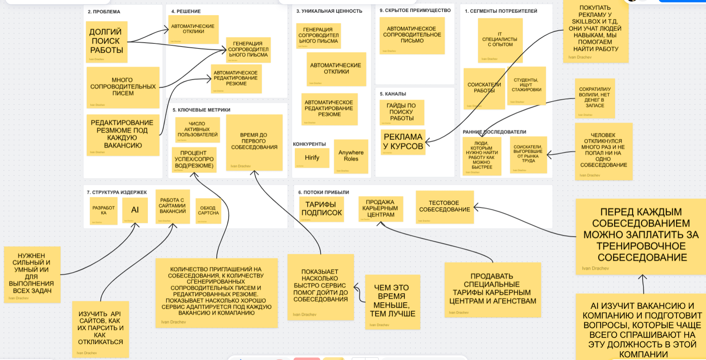
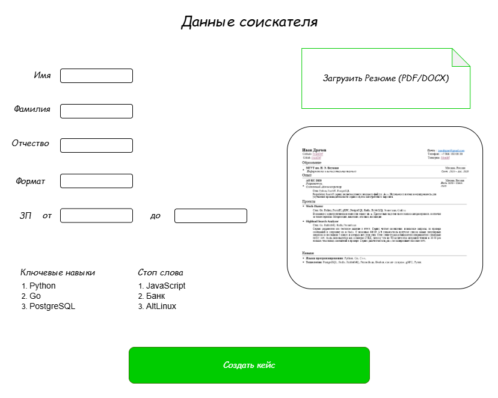
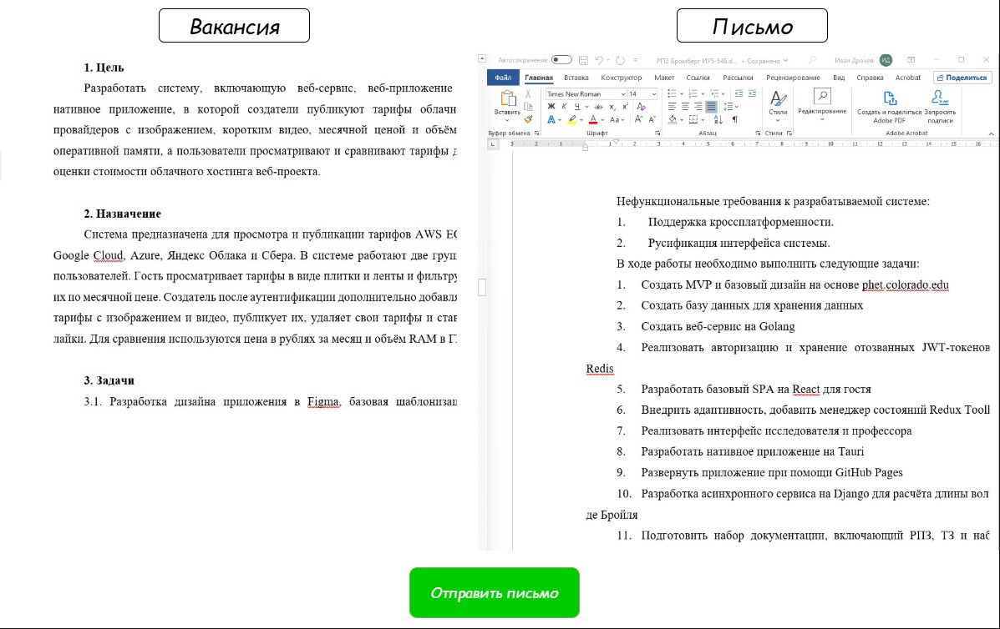
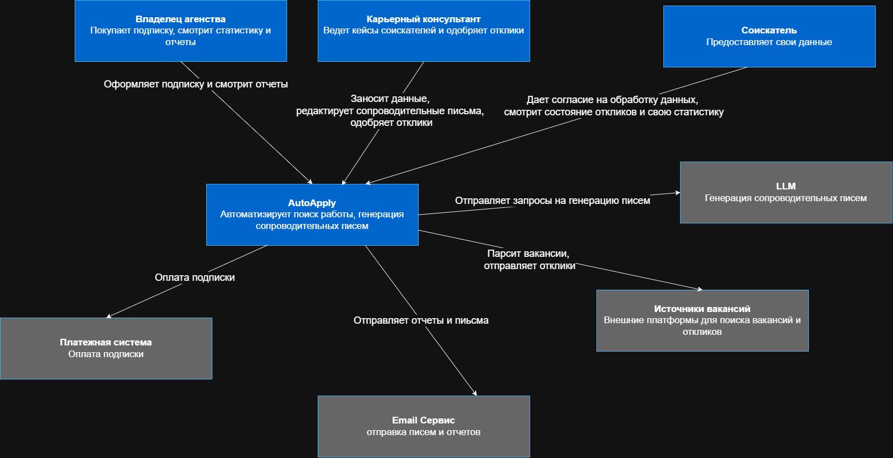
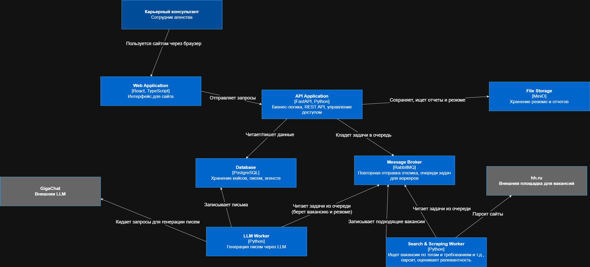

# AutoApply
Проект по дисциплине Методы управления разработкой программного обеспечения

## ДЗ №1

### Основная идея проекта

Сервис, который автоматизирует поиск работы и отклики на вакансии.

### Elevator Pitch

Разработчики и другие соискатели работы тратят много времени на поиск работы на hh.ru и других платформах. Они долго ищут вакансии, которые им подходят, по ЗП, формату работы (удаленка/офис/гибрид), к некоторым вакансиям требуют еще написать сопроводительное письмо, которое занимает очень много времени, и даже после этого соискателю не гарантируется собеседование, то есть человек может впустую потратить значительную часть своего времени. Я предлагаю сервис AutoApply, который сам ищет вакансии по заданным условиям: должность, формат, ЗП. В отличии от агрегаторов вакансий, например, Hirify, моя платформа помимо поиска вакансий, автоматически откликается на них и пишет сопроводительное письмо, заранее изучив эту комапанию и подобрав такие навыки и знания в сопроводительном письме, которые ценятся в этой компании. В результате соискатели экономят себе кучу свободного времени, благодаря более специализированным сопроводительным письмам и большему количеству откликов, чем если бы соискатель оставлял сам, значительно повышают свой шанс на получение работы. 


### Lean Canvas



## ДЗ №2

### Анализ рисков

**Риск жизнеспособности** - самый главный риск проекта. Необходима мощная LLM, которая будет постоянно работать, значит нужно выбирать из передовых моделей, их API может стоить больше прибыли проекта. Чтобы минимизировать этот риск можно некоторую часть отдать своей модели, например, написать свою модель, которая бы выбирала похожие вакансии по требованию пользователя, а не LLM, что значительно снижает расходы. LLM оставить только такие задачи: проводить тестовые собесеодвания, написание сопроводительного письма.

**Риск осуществимости** - сложность разработки, необходимо изучить API сайтов на которых выкладывается вакансия, обойти CAPTCHA и другие способы защиты от ботов.
Чтобы минимизировать этот риск можно изучить инструменты по обходу CAPTCHA и других способов защиты, заранее проверить будут ли они работать на сайтах, которые мы планируем использовать, например hh.ru.

### HADI для риска жизнеспособности

**(H)** Мы верим, что если перераспределить нагрузку между собственной лёгкой моделью и передовой LLM, то стоимость API на одного пользователя снизится настолько, что проект станет рентабельным при среднем жизненном цикле пользователя до 6 месяцев. **(A)** Для этого мы напишем свою модель и обучим ее, траты на нее небольшие, поскольку находить похожие данные в тексте, например, общие теги, технологии и т.д. не сложная задача для машинного обучения. **(D)** Мы замерим какой процент вакансий, который выбрала наша модель понравилась пользователю. **(I)** Если процент вакансий, который понравился пользователю будет больше 70-80%, то модель можно оставить, если же пользователям не нравятся вакансии, которая выбрала модель, то есть <70% или затраты на поддержку модели будут больше, чем затраты на использование LLM, то от гипотезы стоит отказаться и остаться на LLM моедли.

### Юнит экономика

За юнит принимается 1 платящий пользователь-соискатель (B2C-подписка).

#### CAC 

Аудитория - разработчики и IT-специалисты в активном поиске. Каналы: Telegram-каналы по карьере в IT.

Возьмем рекламу в Telegram канале, цена клика `35 рублей`. Переход в регистрацию `25%`. Тогда цена регистрации это `35/0.25 = 140 рублей`. Купят подписку `5%`, тогда `CAC = 140/0.05 = 2800`

Итог: **CAC = 2800 рублей**

---

#### LTV

Пусть подписка будет стоить `1200 руб/мес`.

Посчитаем издержки: возьмем LLM  - `GigaChat Pro Асинхронный режим (0,25 руб/1K)`

Тариф - https://developers.sber.ru/docs/ru/gigachat/tariffs/legal-tariffs?mode=async

Правила тарифа для `GigaChat Pro Асинхронный режим (0,25 руб/1K)`

- Если в течение месяца вы не пользовались сервисом - плата не взимается.
- Если суммарный объем ваших операций меньше 600 рублей - списывается минимальный платеж в размере 600 рублей.
- Если объем вашего использования превышает сумму в 600 рублей - итоговая стоимость определяется согласно выбранному тарифу.

Издержки в виде хостинга, LLM API - 20%

Считаем `LTV = (599 - 0.2 * 599) * 4 = 1916.8 руб` за 4 месяца

`LTV/CAC = 1916.8 / 2800 = 0.68`

**Вывод: экономика НЕ сходится.** LTV меньше CAC . Проект убыточен на каждом привлечённом платящем пользователе. Значит надо перейти на `Pivot`


### Pivot (Business Architecture Pivot)

Переход от B2C (соискатели платят самостоятельно) к B2B карьерным агенствам. В B2B мы можем взимать с компании или агентства во много раз больше за одну сделку, а цикл использования больше не будет ограничен средним временем поиска работы. Будем продавать подписку карьерному агенству, которое помогает людям находить работу. 

Схема:
    
1) Карьерное агенство покупает подписку на наш продукт
2) Человек (соискатель), который ищет работу приходит в карьерное агенство за помощью найти ему работу
3) Сотрудник карьерного агенства заполняет данные о соискателе в наш продукт
4) Наш продукт ищет вакансии для него, откликается и пишет сопроводительные письма
5) Соискатель получает работу

--- 
Большой плюс для карьерного агенства в том, что вместо множества сотрудников, которые бы искали вакансии и скидывали их соискателю, можно испольщовать наш продукт, и тогда карьерное агенство экономит на сотрудниках, подписка будет явно дешевле чем, например, 5 сотрудников, которые бы искали вакансии. Для соискателя удобно, что ему не нужно самому откликаться и писать сопроводительные письма на вакансиии, которые ему предлагает карьерное агенство. К тому же, карьерное агенство может помимо сотрудников использовать терминалы, то есть, соискатель придет и введет данные в терминал и они передадутся в наш продукт - еще одна возможность экономии для карьерного агенства.

### Юнит экономика для Pivot

За юнит принимается 1 платящее карьерное агенство (B2B-подписка).

#### CAC 

Через менеджера обращаться к карьерным агенствам и предлагать им свой продукт. Запрлата менеджера за 2-3 месяца, чтобы найти карьерное агенство, которое согласится и демо версия продукта - `150 000 рублей`

Пусть `30%` карьерных агенств продукт понравился и они купили подписку.

Итог: **CAC = 150 000 / 0.3 = 500 000 рублей**

---

#### LTV

Пусть подписка будет стоить `120 000 руб/мес`.

Заключать договор с агенствами после пробного периода будем на год - `12 месяцев`.

Посчитаем издержки: возьмем LLM  - `GigaChat Pro Асинхронный режим (0,25 руб/1K)`

Тариф - https://developers.sber.ru/docs/ru/gigachat/tariffs/legal-tariffs?mode=async

Правила тарифа для `GigaChat Pro Асинхронный режим (0,25 руб/1K)`

- Если в течение месяца вы не пользовались сервисом - плата не взимается.
- Если суммарный объем ваших операций меньше 600 рублей - списывается минимальный платеж в размере 600 рублей.
- Если объем вашего использования превышает сумму в 600 рублей - итоговая стоимость определяется согласно выбранному тарифу.

Издержки в виде хостинга, LLM API - 25%

Считаем `LTV = (120 000 - 0.25 * 120 000) * 12 = 1 080 000 руб` за 12 месяцев

`LTV/CAC =  1 080 000 / 500 000 = 2.16`

**Вывод: экономика сходится.** LTV больше CAC, значит перейти на Pivot правильная идея.

## ДЗ №3

Рассматривать будем при переходе на Pivot, потому что он прибыльный.


### 1. Определение ролей

**Роли**
- Владелец карьерного агенства (платит подписку за продукт)
- Сотрудник карьерного агенства 
- Соискатель (платит карьерному агенству за трудоустройство)

### 2. User Stories

**Роль: Владелец/руководитель агентства**

1) Как руководитель агентства, я хочу видеть статистику: сколько кейсов обработано, сколько откликов отправлено, сколько приглашений на собеседование получено - чтобы понимать, оправдывает ли подписка себя.

2) Как руководитель, я хочу видеть нагрузку по каждому консультанту, сколько человек у него в работе, - чтобы управлять командой и видеть, стало ли больше соискателей на одного сотрудника, то есть может ли теперь один сотрудник работать с большим количеством соискателей, чем до подписки.

3) Как руководитель, я хочу оформить подписку с годовой предоплатой и закрывающими документами (акт, счёт, договор) - чтобы провести расходы через бухгалтерию.

4) Как руководитель, я хочу настроить роли и доступы сотрудников (консультант / старший консультант / администратор) - чтобы контролировать, кто что видит.

5) Как руководитель, я хочу получать ежемесячный отчёт на email с метриками использования - чтобы не заходить в дашборд каждый день.

6) Как руководитель, я хочу быть уверен, что персональные данные соискателей обрабатываются в соответствии с законами - чтобы не было юридических рисков.

**Роль: Карьерный консультант (сотрудник агентства)**

1) Как консультант, я хочу занести данные соискателя (должность, формат, ЗП, резюме, предпочтения) через простую форму - чтобы запустить поиск за 2–3 минуты.

2) Как консультант, я хочу видеть список подобранных вакансий с релевантностью и объяснением, почему вакансия подходит - чтобы быстро отобрать лучшие.

3) Как консультант, я хочу просмотреть и отредактировать сгенерированное сопроводительное письмо перед отправкой - чтобы контролировать качество и не отправлять «сырое» письмо.

4) Как консультант, я хочу одобрить отклик одной кнопкой (или отклонить с причиной) - чтобы не отправлять всё вслепую.

5) Как консультант, я хочу видеть статус каждого отклика (отправлен / просмотрен / приглашение / отказ) - чтобы отслеживать прогресс кейса.

6) Как консультант, я хочу вести несколько соискателей одновременно в одном интерфейсе (мультикейсовый режим) - чтобы не переключаться между вкладками.

7) Как консультант, я хочу получать уведомление, когда по кейсу пришло приглашение на собеседование - чтобы оперативно связаться с соискателем.

8) Как консультант, я хочу добавить заметку к кейсу (например, «соискатель просил не откликаться на вакансии в банках») - чтобы учитывать индивидуальные предпочтения.

9) Как консультант, я хочу запустить тренировочное собеседование для соискателя (LLM-имитация) и передать ему разбор - чтобы повысить его шансы на реальном интервью.

10) Как консультант, я хочу экспортировать данные кейса (резюме + письма + статусы) в PDF/Excel - чтобы отчитаться перед руководителем или передать соискателю.

**Роль: Соискатель**

1) Как соискатель, я хочу, чтобы агентство занесло мои данные один раз, а не просило заполнять анкеты заново - чтобы не тратить время.

2) Как соискатель, я хочу видеть, на какие вакансии были отправлены отклики от моего имени - чтобы контролировать процесс.

3) Как соискатель, я хочу иметь возможность отозвать согласие на автоматические отклики в любой момент - чтобы контролировать свои данные.

4) Как соискатель, я хочу получать от консультанта разбор тренировочного собеседования - чтобы понять, где я слаб.


### 3. Приоритизация MoSCoW

**M - Must have (обязано быть в MVP)**

- форма занесения данных соискателя

- список подобранных вакансий с релевантностью

- просмотр/редактирование письма перед отправкой

- одобрение отклика одной кнопкой

- статус каждого отклика

- соискатель видит, куда отправлены отклики

- оформление подписки с закрывающими документами

- онбординг агентства за 1 день

- соблюдение законов о персональных данных

**S - Should have (в MLP)**

- дашборд для руководителя

- нагрузка по консультантам

- мультикейсовый режим

- уведомления о приглашениях

- заметки к кейсу

- не шаблонные письма

- отзыв согласия соискателем

- метрики использования по агентствам

- роли и доступы

- ежемесячный отчёт на email

**C - Could have (после MLP)**

- тренировочные собеседования с разбором

- экспорт кейса в PDF/Excel

- разбор собеседования для соискателя

- SLA и приоритетная поддержка

- смена тарифа онлайн

**W - Won't have (не в этот цикл)**

- Голосовое общение с LLM в режиме тестового собеседования

- Мобильное приложение для соискателей

- Интеграция с hh.ru API напрямую (на старте - через парсинг/ручной экспорт)


### 4. MVP и MLP

**MVP:** 
- консультант агентства заносит данные соискателя,

- система подбирает вакансии 

- генерирует сопроводительные письма

- консультант проверяет и одобряет 

- отклики отправляются 

- консультант видит статусы. 

- Руководитель оформил подписку с документами. Соискатель видит, куда отправлены отклики.


**MLP**

**Что добавляется:**  
дашборд для руководителя, мультикейсовый режим, уведомления о приглашениях, заметки к кейсу, отзыв согласия, метрики по агентствам, роли и доступы, ежемесячный отчёт.


### 5. Анализ ФТ/НФТ по двум ключевым историям

Выбираю две самые важные истории из Must have: **(занесение данных соискателя)** и **(просмотр/редактирование письма перед отправкой)** - без них агентство не получит ценности.

**Занесение данных соискателя**

**ФТ (что система должна уметь):**
- Форма с полями: должность, формат работы (удалёнка/офис/гибрид), желаемая ЗП (мин/макс), город, резюме (загрузка PDF/DOCX или вставка текста), ключевые навыки (теги), предпочтения.

- Валидация: обязательные поля (должность, формат, резюме), проверка формата ЗП, проверка размера файла резюме.

- Автосохранение черновика каждые 30 секунд - чтобы консультант не потерял данные при сбое.

- Парсинг резюме: извлечение навыков, опыта, образования из загруженного PDF/DOCX.

- Привязка кейса к консультанту (кто создал) и к агентству

- Возможность редактировать данные после создания кейса.

**НФТ (требования к работе системы):**
- Загрузка и парсинг должен быть быстрым.

- Форма корректно отображается на компьютере и планшете 

- Данные соискателя шифруются в покое и при передаче.

- Доступ к кейсу только у консультанта, создавшего его, и у руководителя агентства.

- Система должна выдерживать высокую нагрузку.

**Просмотр и редактирование письма перед отправкой**

**ФТ (что система должна уметь):**
- Отображение сгенерированного письма рядом с текстом вакансии и профилем соискателя - чтобы консультант видел контекст.

- Возможность правки текста: редактирование, сохранение версии.

- Кнопки: `Одобрить и отправить`, `Перегенерировать`, `Отклонить с причиной`.

- При `Перегенерировать` - запрос к LLM с учётом правок консультанта.

- Индикатор `письмо изменено консультантом»` - чтобы руководитель видел, сколько писем правят (метрика качества LLM).

- История версий письма, чтобы можно было посмотреть, что поменял сотрудник карьерного агенства.

**НФТ (требования к работе системы):**.
- Редактор работает без задержек при тексте до 5 000 символов.

- Автосохранение правок каждые 10 секунд - чтобы не потерять при сбое.

- Письмо не отправляется без явного одобрения консультанта.

- Все версии письма хранятся 90 дней (для разбора споров).

- Система логирует, кто одобрил отправку - ответственность за качество, чтобы нельзя было специально портить письма.


## ДЗ №4


### 1. DDD (Domain-Driven Design)

Делим приложение на 4 домена.

**Домент 1: Управление кейсами**

**Описание:** Отвечает за создание, хранение и редактирование профилей соискателей, их предпочтений и привязку к конкретному карьерному консультанту.

**Глоссарий:**
    
**Кейс** - набор из соискателя, его предпочтения и привязанного к нему консулььтанту.
    
**Соискатель** - человек, который обратился за помощью в карьерный центр. Конечный пользователь, чьи данные заносятся в систему.
    
**Консультант** - сотрудник карьерного агентства, работающий с кейсом.
    
**Предпочтения** - формат работы, желаемая ЗП, стоп-слова.

---

**Домен 2: Поиск вакансий**

**Описание:** Интеграция с площадками вакансий (hh.ru и т.д.), парсинг данных, применение ML-модели для поиска релевантных вакансий, которые подохдят под соискателя.

**Глоссарий:**

**Вакансия** - предложение о работе, полученное с истоника вакансий.

**Релевантность** - процент, показывающий насколько вакансия подходит под параметры кейса.

**Источник вакансий** - внешняя платформа (hh.ru, Хабр Карьера и т.д.).

**Соответствие** - процесс сопоставления профиля соискателя и вакансии.

---

**Домен 3: Генерация и Отклики**

**Описание:** Взаимодействие с LLM для написания сопроводительных писем, управление версиями писем, контроль одобрения консультантом и отправка отклика.

**Глоссарий:**

**Сопроводительное письмо** - текст, сгенерированный LLM или отредактированный консультантом для отклика на вакансию.

**Одобрение** - действие консультанта, разрешающее отправку отклика.

**Отклик** - отправка резюме и письма на вакансию.

**Версия** - зафиксированное состояние письма до или после правок консультанта.

---

**Домен 4: Администрирование**

**Описание:** Управление подписками B2B-клиентов, разграничение прав доступа, формирование отчетов.

**Глоссарий:**

**Агентство** - B2B-клиент, оплачивающий подписку.

**Владелец** - руководитель агентства, имеющий доступ к статистике.

**Подписка** - договор на использование сервиса.

**Роль** - уровень доступа (Консультант, Администратор, Владелец).

---

### 2. BDD (Behavior-Driven Development): 

**Критический путь:** 

1) Занесение данных соискателя 
2) Подбор вакансии
3) Генерация и одобрение сопроводительного письма
4) Отправка отклика.

---

**Сценарий успеха**

**Дано:** Консультант авторизован в системе и находится на странице создания нового кейса. Загружено резюме соискателя в формате PDF.

**И:** Система успешно распарсила резюме и заполнила поля.

**Когда:** Консультант заполняет желаемую зарплату, выбирает формат работы и нажимает кнопку `Найти вакансии`, а затем выбирает одну или несколько из подобранных вакансий, отсортированных по `Релевантности` и нажимает кнопку `Сгенерировать письмо` для тех, которые он считает лучше всего подходят соискателю из предложенных.

**Тогда:** Система отображает сгенерированное LLM сопроводительное письмо в редакторе, а рядом - текст вакансии.

**И:** Консультант нажимает `Одобрить и отправить`.

**Результат:** Отклик успешно отправлен на внешний источник вакансий, статус отклика в системе меняется на `Отправлен`.

---

**Сценарий отказа**

**Дано:** Консультант находится на экране проверки сопроводительного письма.

**И:** API-key к внешнему API hh.ru истек или сработала CAPTCHA-защита.

**Когда:** Консультант нажимает кнопку `Одобрить и отправить`.

**Тогда:** Система не отправляет отклик, а показывает модальное окно с ошибкой: `В данный момент не удалось отправить отклик, но он будет отправлен в ближайшее время`.

**И:** Статус отклика остается `Ожидает отправки`. Приложение сохраняет себе не дотправившиеся отклики в брокер сообщенией и будет пытаться отправить их снова, анализируя ошибки: API-key истек, значит нужно полчить новый и т.д.


### 3. Wireframes

Набросок экрана добавления данных о соискателе



Набросок экрана редактирования сопроводительного письма и просмотра вакансии




### 4. JSON контракты

**Создание кейса** 

URL: POST `/api/cases/create`

Request JSON
```json
{
    "applicant": {
        "firstname": "Иван",
        "lastname": "Драчев",
        "surname": "Юрьевич",
        "resume_file_id": "file_987654321",
        "skills": [
            "Python",
            "Go",
            "PostgreSQL"
        ]
    },

    "preferences": {
        "position": "Backend Python Developer",
        "format": [
            "remote",
            "hybrid"
        ],
        "salary": {
            "min": 150000,
            "max": 250000
        },
        "stop_words": [
            "Банк",
            "JavaScript",
            "AltLinux"
        ]
    },
    "consultant_id": "cons_id"
}
```

Response JSON (201 Created)
```json
{
    "case_id": "case_id",
    "created_at": "2026-11-27T10:00:00Z"
}
```

---

**Отправка отклика**

URL: POST `/api/cases/{case_id}/applications/{application_id}/approve`

Request JSON

```json
{
    "cover_letter": {
        "text": "Здравствуйте! Меня заинтересовала ваша вакансия Middle Python Dev",
        "is_edited_by_consultant": true,
        "llm_generation_id": "gen_id"
    },
    "consultant_id": "cons_id"
}
```

Response JSON (201 Created)
```json
{
    "application_id": "app_id",
    "sent_at": "2023-10-27T10:05:00Z",
    "external_platform": {
        "name": "hh.ru",
        "external_application_id": "hh_123456789"
    }
}
```

## ДЗ №5

### 1. Схема C4 Контекста




### 2. Схема C4 Контейнеров



**Стек:**

**Backend: Python (FastAPI или Django)**

**Обоснование:** Python - позволяет очень быстро написать MVP из-за большого количества готовых решений, веб-скрапинга и интеграции с ML/LLM. FastAPI обеспечивает высокую производительность, что важно, из-за работы с внешними API (hh.ru, GigaChat). Для фильтрации запросов и отдачи статики - **Nginx**.

---

**Frontend: React (TypeScript)**

**Обоснование:** SPA-архитектура позволит сделать удобрный интерфейс для консультантов с форм и динамических списков. TypeScript удобнее для написания кода чем JS из-за типизации.

---

**База данных: PostgreSQL**

**Обоснование:** Реляционная СУБД, которая подходит для хранений для строгой структуры данных и поддержкой ACID . Также позволяет хранить вектора через `pg_vector`, что удобно для хранения резюме в векторном виде.

---

**Брокер сообщений и очереди: RabbitMQ**

**Обоснование:**  Чтобы не ожидать ответа от воркеров, например, воркер, который парсит сайты может отвечать на запрос больше минуты и чтобы не ждать его, отправляем задачу в брокер, а когда он ее сделает, то сам отправит в брокер и мы получим результат.
Удобно для асинхронного общения воркеров между собой

---

**Хранение файлов: MiniO**

**Обоснование:** Хранение файлов не локально, из-за чего может закончиться место на диске, а в MiniO, которое можно постоянно расширять, добавляя новые кластеры и более удобная работа с файлами, нежели если хранить их локльно.

---

**Внешние интеграции:**

**GigaChat API:** выбран по экономике.

**Источники вакансий:** работа с источниками вакансий: hh.ru, Хабр карьера и т.д., работа с API и или парсинг.