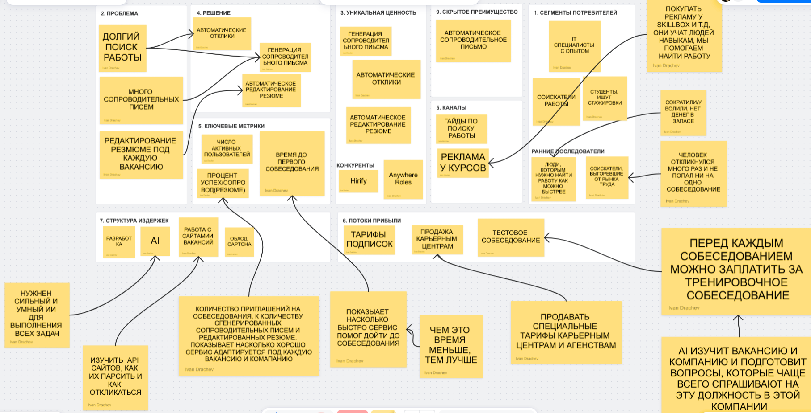

# AutoApply
Проект по дисциплине Методы управления разработкой программного обеспечения

## ДЗ №1

### Основная идея проекта

Сервис, который автоматизирует поиск работы и отклики на вакансии.

### Elevator Pitch

Разработчики и другие соискатели работы тратят много времени на поиск работы на hh.ru и других платформах. Они долго ищут вакансии, которые им подходят, по ЗП, формату работы (удаленка/офис/гибрид), к некоторым вакансиям требуют еще написать сопроводительное письмо, которое занимает очень много времени, и даже после этого соискателю не гарантируется собеседование, то есть человек может впустую потратить значительную часть своего времени. Я предлагаю сервис AutoApply, который сам ищет вакансии по заданным условиям: должность, формат, ЗП. В отличии от агрегаторов вакансий, например, Hirify, моя платформа помимо поиска вакансий, автоматически откликается на них и пишет сопроводительное письмо, заранее изучив эту комапанию и подобрав такие навыки и знания в сопроводительном письме, которые ценятся в этой компании. В результате соискатели экономят себе кучу свободного времени, благодаря более специализированным сопроводительным письмам и большему количеству откликов, чем если бы соискатель оставлял сам, значительно повышают свой шанс на получение работы. 

### Lean Kanvas

## ДЗ №2

### Анализ рисков

**Риск жизнеспособности** - самый главный риск проекта. Необходима мощная LLM, которая будет постоянно работать, значит нужно выбирать из передовых моделей, их API может стоить больше прибыли проекта. Чтобы минимизировать этот риск можно некоторую часть отдать своей модели, например, написать свою модель, которая бы выбирала похожие вакансии по требованию пользователя, а не LLM, что значительно снижает расходы. LLM оставить только такие задачи: проводить тестовые собесеодвания, написание сопроводительного письма.

**Риск осуществимости** - сложность разработки, необходимо изучить API сайтов на которых выкладывается вакансия, обойти CAPTCHA и другие способы защиты от ботов.
Чтобы минимизировать этот риск можно изучить инструменты по обходу CAPTCHA и других способов защиты, заранее проверить будут ли они работать на сайтах, которые мы планируем использовать, например hh.ru.

### HADI для риска жизнеспособности

**(H)** Мы верим, что если перераспределить нагрузку между собственной лёгкой моделью и передовой LLM, то стоимость API на одного пользователя снизится настолько, что проект станет рентабельным при среднем жизненном цикле пользователя до 6 месяцев. **(A)** Для этого мы напишем свою модель и обучим ее, траты на нее небольшие, поскольку находить похожие данные в тексте, например, общие теги, технологии и т.д. не сложная задача для машинного обучения. **(D)** Мы замерим какой процент вакансий, который выбрала наша модель понравилась пользователю. **(I)** Если процент вакансий, который понравился пользователю будет больше 70-80%, то модель можно оставить, если же пользователям не нравятся вакансии, которая выбрала модель, то есть <70% или затраты на поддержку модели будут больше, чем затраты на использование LLM, то от гипотезы стоит отказаться и остаться на LLM моедли.

### Юнит экономика

За юнит принимается 1 платящий пользователь-соискатель (B2C-подписка).

#### CAC 

Аудитория — разработчики и IT-специалисты в активном поиске. Каналы: Telegram-каналы по карьере в IT.

Возьмем рекламу в Telegram канале, цена клика `35 рублей`. Переход в регистрацию `25%`. Тогда цена регистрации это `35/0.25 = 140 рублей`. Купят подписку `5%`, тогда `CAC = 140/0.05 = 2800`

Итог: **CAC = 2800 рублей**

---

#### LTV

Пусть подписка будет стоить `1200 руб/мес`.

Посчитаем издержки: возьмем LLM  - `GigaChat Pro Асинхронный режим (0,25 руб/1K)`

Тариф - https://developers.sber.ru/docs/ru/gigachat/tariffs/legal-tariffs?mode=async

Правила тарифа для `GigaChat Pro Асинхронный режим (0,25 руб/1K)`

- Если в течение месяца вы не пользовались сервисом — плата не взимается.
- Если суммарный объем ваших операций меньше 600 рублей — списывается минимальный платеж в размере 600 рублей.
- Если объем вашего использования превышает сумму в 600 рублей — итоговая стоимость определяется согласно выбранному тарифу.

Издержки в виде хостинга, LLM API - 20%

Считаем `LTV = (599 - 0.2 * 599) * 4 = 1916.8 руб` за 4 месяца

`LTV/CAC = 1916.8 / 2800 = 0.68`

**Вывод: экономика НЕ сходится.** LTV меньше CAC . Проект убыточен на каждом привлечённом платящем пользователе. Значит надо перейти на `Pivot`

### Pivot (Business Architecture Pivot)

Переход от B2C (соискатели платят самостоятельно) к B2B карьерным агенствам. В B2B мы можем взимать с компании или агентства во много раз больше за одну сделку, а цикл использования больше не будет ограничен средним временем поиска работы. Будем продавать подписку карьерному агенству, которое помогает людям находить работу. 

Схема:
    
1) Карьерное агенство покупает подписку на наш продукт
2) Человек (соискатель), который ищет работу приходит в карьерное агенство за помощью найти ему работу
3) Сотрудник карьерного агенства заполняет данные о соискателе в наш продукт
4) Наш продукт ищет вакансии для него, откликается и пишет сопроводительные письма
5) Соискатель получает работу

--- 
Большой плюс для карьерного агенства в том, что вместо множества сотрудников, которые бы искали вакансии и скидывали их соискателю, можно испольщовать наш продукт, и тогда карьерное агенство экономит на сотрудниках, подписка будет явно дешевле чем, например, 5 сотрудников, которые бы искали вакансии. Для соискателя удобно, что ему не нужно самому откликаться и писать сопроводительные письма на вакансиии, которые ему предлагает карьерное агенство. К тому же, карьерное агенство может помимо сотрудников использовать терминалы, то есть, соискатель придет и введет данные в терминал и они передадутся в наш продукт - еще одна возможность экономии для карьерного агенства.

### Юнит экономика для Pivot

За юнит принимается 1 платящее карьерное агенство (B2B-подписка).

#### CAC 

Через менеджера обращаться к карьерным агенствам и предлагать им свой продукт. Запрлата менеджера за 2-3 месяца, чтобы найти карьерное агенство, которое согласится и демо версия продукта - `150 000 рублей`

Пусть `30%` карьерных агенств продукт понравился и они купили подписку.

Итог: **CAC = 150 000 / 0.3 = 500 000 рублей**

---

#### LTV

Пусть подписка будет стоить `120 000 руб/мес`.

Заключать договор с агенствами после пробного периода будем на год - `12 месяцев`.

Посчитаем издержки: возьмем LLM  - `GigaChat Pro Асинхронный режим (0,25 руб/1K)`

Тариф - https://developers.sber.ru/docs/ru/gigachat/tariffs/legal-tariffs?mode=async

Правила тарифа для `GigaChat Pro Асинхронный режим (0,25 руб/1K)`

- Если в течение месяца вы не пользовались сервисом — плата не взимается.
- Если суммарный объем ваших операций меньше 600 рублей — списывается минимальный платеж в размере 600 рублей.
- Если объем вашего использования превышает сумму в 600 рублей — итоговая стоимость определяется согласно выбранному тарифу.

Издержки в виде хостинга, LLM API - 25%

Считаем `LTV = (120 000 - 0.25 * 120 000) * 12 = 1 080 000 руб` за 12 месяцев

`LTV/CAC =  1 080 000 / 500 000 = 2.16`

**Вывод: экономика сходится.** LTV больше CAC, значит перейти на Pivot правильная идея.
